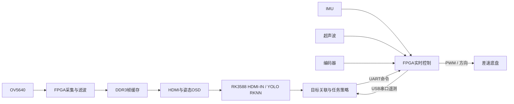

# FPGA + RK3588 具身智能机器人

全国大学生嵌入式芯片与系统设计竞赛 · FPGA创新设计赛道 · 高云半导体选题三：**基于FPGA的具身智能机器人实时感知与自主控制系统设计**。

本项目采用 **ACG720 / GW5AT-60B + RK3588** 协同架构：FPGA负责视频采集显示、姿态感知、电机闭环及实时避障；RK3588负责目标检测、跟随决策和红色水瓶搜索靠近。

## 功能与代码入口

| 任务 | 实现 | 主要入口 |
|---|---|---|
| 1 多传感器感知 | OV5640采集、DDR3帧缓存、HDMI、IMU与姿态OSD | [FPGA顶层](fpga/src/ov5640_ddr3_hdmi.v) |
| 2 运动控制 | 编码器反馈、定点PID、方向/PWM及差速执行 | [motion_ctrl.v](fpga/src/motion/motion_ctrl.v) |
| 3 实时避障 | 超声波轮询、距离保护与避障状态机 | [avoid_fsm.v](fpga/src/avoid/avoid_fsm.v) |
| 4 自主导航 | 固定场景双障碍绕行，v48尾段三次左转和里程控制 | [task4_seg1_fsm.v](fpga/src/task4/task4_seg1_fsm.v) |
| 5 指定目标跟随 | 红色书包等目标关联、双阈值续跟、连续差速控制 | [follow_policy.py](software/task5_follow/follow_policy.py) |
| 6 智能任务执行 | 红瓶检测、颜色引导、书包方位排除、到距停车 | [red_bottle_target.py](software/task6_red_bottle/red_bottle_target.py) |

任务四当前启用固定路线引擎；通用[路点导航引擎](fpga/src/nav/nav_fsm.v)源码保留，默认关闭。任务五、六保留独立策略快照，同名文件应在各自目录中使用。

## 系统结构



## 仓库目录

```text
fpga/                    Gowin工程、RTL、引脚及时序约束
software/
  detector/              RKNN检测器、YOLO后处理、V4L2和UART接口
  task5_follow/          任务五策略、执行器及离线测试
  task6_red_bottle/      任务六搜索靠近策略及网页服务
  runtime/              板端预览采集辅助脚本
sim/rtl/                 RTL回归测试平台
web/                     上位机网页、HTTP API、静态资源及启动配置
scripts/                 仓库检查和离线验证入口
firmware/                已绑定源码版本的0x325C位流
models/                  外部模型与标签的放置说明
docs/                    架构、算法、构建、部署和验证说明
```

## 快速开始

### 1. 检查源码与运行离线验证

需要Python 3.9+；RTL测试另需Icarus Verilog。命令不会连接开发板。

```bash
python scripts/check_repository.py
python scripts/run_python_tests.py
python scripts/run_rtl.py
python web/app.py --check
python web/test_web.py
```

RGB原语测试需要本地Gowin仿真库，通过`GOWIN_SIMLIB`指定`prim_sim.v`；未设置时明确跳过该项。其余RTL测试可独立运行。

### 2. 构建FPGA工程

使用 **Gowin EDA V1.9.12 x64**，器件`GW5AT-LV60PG484AC1/I0`。顶层模块实际名称为`gao_ov5640_ddr_hdmi`。

```bash
gw_sh fpga/build.tcl
```

完整步骤和报告检查见[构建说明](docs/build.md)。工程使用相对路径，保留`timing_driven=1`、`place_option=4`及现有约束。

### 3. 准备RK3588

检测器采用C++11、V4L2与RKNN Runtime。随包已含匹配模型、priors及标签，先按[模型说明](models/README.md)核验资产，再按[部署说明](docs/deployment.md)配置设备及运行路径。

```bash
cd software/detector
make abi
make
```

### 4. 启动上位机网页

当前现场网址为`http://10.36.218.39:8080`；新设备使用实际RK地址。网页入口已整理到[web目录](web/README.md)，HTML、CSS和JavaScript分别保存，服务保持原在线API。

在RK3588 Linux上准备好串口、模型及检测器后：

```bash
chmod +x software/runtime/grab_loop2.sh software/runtime/vision_ctl.sh
CMD_DEV=/dev/ttyS0 TLM_DEV=/dev/ttyUSB0 SPEED_MAX=24 python3 web/app.py
```

页面提供手动遥控、停止/急停、任务三/四FPGA入口、任务五/六、视频及遥测。已有carweb运行时，按[部署说明](docs/deployment.md)选择单一服务入口。

### 5. 运行独立策略计算

独立策略实验使用自己的服务快照和控制权接口，先核对接口匹配并使用无运动输出模式：

```bash
cd software/task5_follow
python3 run_follow_trial.py --mode dry --profile BAG --variant S5 \
  --seconds 5 --far-speed 22 --run-id demo_dry
```

车辆运动需要显式启用LIVE、有效遥测及现场准备。任务六的`run_red_bottle.py`默认DRY，详见对应[模块说明](software/README.md)。

## 主要算法设计

- **有限窗口的硬件图像处理**：水平五点中值网络分级实现，RGB中性补偿使用LUT，降低组合路径和乘法资源开销。
- **固定点闭环与角度规约**：编码器速度闭环，导航误差规约到±180°；尾段使用绝对误差判停与有限次数微修正。
- **目标身份连续性**：首次获取与低分续跟采用不同门槛，并结合IoU、颜色和尺度约束；红色维持具有范围和期限。
- **统一控制出口**：策略先生成请求，再统一处理整形、输入时效、距离和状态限幅。
- **搜索与靠近分阶段**：红色区域提供方位线索，瓶子类别与颜色用于锁定；到达距离或画面尺度门槛后停止。

公式、边界和代码定位见[算法说明](docs/algorithms.md)，每个源码文件的职责见[代码索引](docs/code_map.md)。

## 版本与验证状态

本仓库整理自**2026-11-02任务四v48集成版**。随包位流为`firmware/integrated_t4v48_uc325c.fs`，UserCode **0x0000325C**。

- 六组RTL回归、RGB 65,536输入、微修正262,144输入等价检查已在集成版完成。
- 该位流已完成静态板验：视频持续更新、姿态OSD及遥测正常。
- **2026-11-03用户补充实测反馈：其余功能均已验证正确。** 自动化保留静态、模式接口及DRY计算证据；用户未另附逐项测量数据。原50Hz/10Hz仿真边界仍见验证说明。
- 各时钟同域setup/hold满足既有目标；DDR IP及复位相关跨时钟负路径仍有保留，不能视为全设计零违例。

详见[验证说明](docs/validation.md)。控制算法与FPGA约束保持来源版本；网页以当前在线快照为准，拆分静态资源并增加仓库相对路径配置。2026-11-03已完成新网页部署、同颗FS下载及静态复核；红瓶40/40新帧检出，160拍DRY锁定通过。自动化阶段未开启实车跟随；后续用户已反馈其余功能均验证正确，详见[板端复核](docs/board_validation.md)。

## 资料与第三方组件

- [高云官方赛题说明](https://www.gowinsemi.com.cn/university/match2026)
- [第三方组件与来源](THIRD_PARTY_NOTICES.md)
- [README组织方式参考](docs/references.md)

厂商IP保留原始版权及生成内容；随包模型保留来源与许可，SDK和运行库需按其使用条件安装。离线对比工具见[重放说明](docs/replay.md)。

最新版上传包包含完整FPGA/RK源码、独立网页、三个匹配模型资产、0x325C烧录FS和配套构建/验证说明。解压后将`fpga-rk3588-embodied-robot`目录内的内容作为GitHub仓库根；步骤见[上传说明](docs/github_submission.md)。
